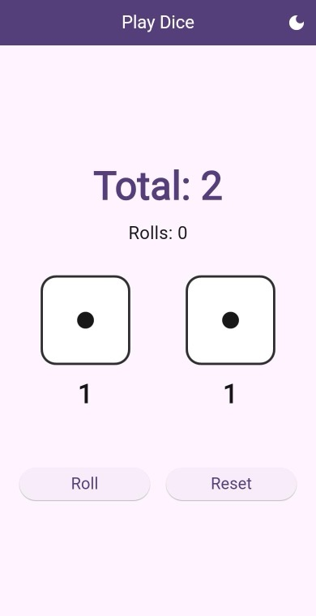
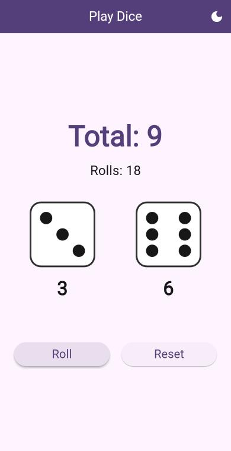
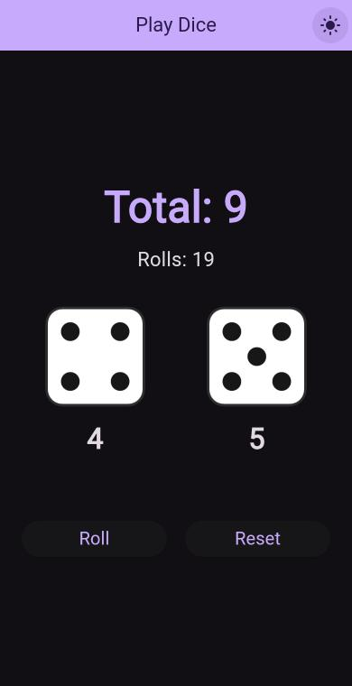

<div align="center">

# 🎲 Play Dice

**Flutter — Section 2 task**

### [▶ Play it live](https://amr-elgharip2006.github.io/flutter-play-dice/)

&nbsp;&nbsp;
&nbsp;&nbsp;


</div>

---

Two dice, a total, and Roll / Reset buttons. It's the Section 2 app with the practice exercises added on top.

## What I added

- [x] **New theme**: deep purple, with a light / dark switch in the app bar
- [x] **Bigger text** for the total and the dice values
- [x] **Dice images** instead of plain numbers
- [x] **Roll counter**, which goes back to 0 on Reset
- [x] **"Doubles!"** message when both dice are the same
- [x] **Clean names**: `MyApp`, `PlayDice`, `value1`, `value2`
- [x] **setState experiment** (below)

## Without `setState()`

If you remove `setState()` from `roll()`, the values still change (you can print them), but the screen stays the same.
Flutter only calls `build()` again after `setState()`, so the UI never finds out that anything changed.

## Run it

```bash
flutter pub get
flutter run
```

Tests: `flutter test`

---

<sub>Amr Ahmed Elgharip · based on [flutter-course-section-2](https://github.com/Atef-Mousa/flutter-course-section-2)</sub>
